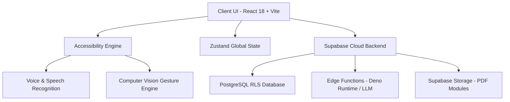

# 🌟 BintangAi (2026 Next-Gen Edition)
### *Empowering Inclusive Education Through Adaptive Multimodal AI*

[](https://reactjs.org/)
[](https://vitejs.dev/)
[](https://tailwindcss.com/)
[](https://supabase.com/)
[](https://github.com)

---

## 📌 Deskripsi Singkat

**BintangAi** adalah platform pembelajaran digital inklusif generasi baru tahun 2026 yang memanfaatkan **Kecerdasan Buatan Multi-Modal (Multimodal AI)**, **Interaksi Suara (Voice-First)**, dan **Deteksi Gestur Visual Real-time** untuk meruntuhkan batasan belajar bagi penyandang disabilitas (Tunanetra, Tunarungu, dan Tunawicara) di Sekolah Luar Biasa (SLB) dan sekolah inklusif.

Melalui pendampingan cerdas **Kak Bintang (AI Tutor)**, setiap anak memiliki kesempatan yang sama untuk tumbuh, belajar mandiri, dan mengasah potensi terbaik mereka secara interaktif.

---

## 🌟 Fitur Inovasi Utama (Edition 2026)

### 🦯 1. Mode Aksesibilitas Tunanetra (Visually Impaired)
- **Asisten Voice-First (Kak Bintang Voice)**: Navigasi dan tanya-jawab materi berbasis suara natural. Cukup tekan tombol suara atau gunakan perintah vokal.
- **Auto Screen Reader & Audio Guide**: Penjelasan struktur halaman otomatis saat pengguna berpindah menu.
- **Haptic & Sound Feedback**: Konfirmasi audio instan untuk setiap interaksi tombol dan form.

### 🤟 2. Mode Aksesibilitas Tunarungu & Tunawicara (Hearing & Speech Impaired)
- **Real-Time Live Subtitles**: Transkripsi ucapan guru atau audio menjadi subtitle teks berakurasi tinggi secara langsung.
- **Kamera Navigasi Gestur (Vision Control)**: Mengontrol navigasi dan aksi aplikasi menggunakan gerakan 1–10 jari tanpa menyentuh layar.
- **Antarmuka Visual Adaptif**: Tipografi berkontras tinggi dan ukuran teks yang dinamis untuk kenyamanan membaca maksimal.

### 🎮 3. Gamifikasi & Motivasi Belajar
- **Sistem XP & Leveling**: Siswa mendapatkan Experience Points (XP) dari penyelesaian modul dan tugas.
- **Streak Counter**: Lacak konsistensi belajar harian siswa.
- **Efek Confetti Interaktif**: Perayaan visual menarik setiap kali siswa menyelesaikan kuis atau latihan.

### 👨‍🏫 4. Ekosistem Multi-Peran Terpadu
- **Dashboard Siswa**: Ruang belajar pribadi lengkap dengan modul, kuis, arena eksperimen (playground), dan Tanya AI.
- **Dashboard Guru**: Pusat pengelolaan materi, pembuatan tugas, dan pemantauan statistik perkembangan siswa.
- **Dashboard Orang Tua**: Ringkasan laporan kemajuan anak dan komunikasi langsung dengan tenaga pendidik.

---

## 🛠️ Arsitektur & Teknologi (Tech Stack 2026)



### Stack Spesifikasi
- **Frontend**: React 18, Vite 4, Tailwind CSS, Framer Motion, React Icons / Lucide Icons.
- **State Management**: Zustand (ringan, cepat, dan reaktif).
- **Backend & Database**: Supabase PostgreSQL dengan *Row Level Security* (RLS) ketat.
- **Serverless Compute**: Supabase Edge Functions (Deno Runtime) untuk pemrosesan AI Tutor & Vision OCR.
- **Routing**: React Router DOM v6 dengan *Lazy Loading* & *Code Splitting*.

---

## 📂 Struktur Proyek (Terorganisir & Standar 2026)

```text
SambungJaga/
├── public/                 # Aset statis & manifes PWA
├── src/
│   ├── components/         # Komponen UI modular
│   │   ├── feedback/       # ConfettiEffect, LoadingOverlay, NotificationContainer
│   │   ├── layout/         # AppLayout, TeacherSidebar, StudentSidebar, ParentSidebar
│   │   └── ui/             # Button, Card, AudioPlayer (Reusable UI)
│   ├── features/           # Arsitektur Domain-Driven Design (DDD)
│   │   ├── accessibility/  # GlobalGestureCamera, Subtitles, BlindAIAssistant, VoiceNav
│   │   ├── ai-tutor/       # BintangAvatar, ChatBubble, useAI, useBintangVoice
│   │   ├── auth/           # Session API, InactivityLogout, Auth Store
│   │   ├── gamification/   # XPBar, StreakBadge, xpApi, xpStore
│   │   └── quiz/           # Tasks, SubmitResultApi, GenerateQuizApi
│   ├── hooks/              # Custom React Hooks (useNotification, dll)
│   ├── lib/                # Supabase Client & API Instance
│   ├── pages/              # Halaman Berdasarkan Peran
│   │   ├── auth/           # LoginPage.jsx, RegisterPage.jsx, LandingPage.jsx
│   │   ├── student/        # Dashboard, Modules, Quiz, TanyaAI, Playground
│   │   ├── teacher/        # Dashboard, UploadModule, CreateTask, Chat
│   │   ├── parent/         # Dashboard, Chat
│   │   └── profile/        # Profil Pengguna & Setting Aksesibilitas
│   ├── styles/             # globals.css, adaptive.css
│   ├── utils/              # Helper utilities
│   │   └── common/         # validators.js, formatters.js
│   ├── App.jsx             # Main Application Routing
│   └── main.jsx            # Entry point & Accessibility Bootstrapper
├── package.json
├── tailwind.config.js
├── vite.config.js
└── README.md
```

---

## 🚀 Panduan Instalasi & Jalankan Aplikasi

### 1. Prasyarat
Pastikan lingkungan Anda telah terinstal:
- **Node.js**: `v18.0.0` atau versi lebih baru
- **npm** atau **pnpm**

### 2. Clone Repository
```bash
git clone https://github.com/s1informatika11s25007-maker/SambungJagaAI.git
cd SambungJagaAI
```

### 3. Instalasi Dependensi
```bash
npm install
```

### 4. Konfigurasi Environment Variables (`.env`)
Buat file `.env` di direktori utama proyek:
```env
VITE_SUPABASE_URL=https://your-supabase-project.supabase.co
VITE_SUPABASE_ANON_KEY=your-supabase-anon-key
```

### 5. Jalankan Mode Pengembang (Development)
```bash
npm run dev
```
Buka browser di `http://localhost:5173`.

### 6. Build Produksi
```bash
npm run build
```

---

## 🔐 Keamanan & Integritas Data (PDP Compliance)

- **Row Level Security (RLS)**: Data kuis, jawaban siswa, dan profil pengguna dilindungi RLS Supabase sehingga hanya pemilik role resmi yang dapat mengaksesnya.
- **Inactivity Session Lock**: Fitur otomatis pemutusan sesi saat pengguna tidak aktif untuk melindungi kerahasiaan data anak.
- **Protected Environment Credentials**: Pemisahan variabel kredensial publik dan privat secara aman.

---

## 🤝 Lisensi & Kontribusi

Proyek ini dikembangkan sebagai bagian dari ekosistem digital inklusif **BintangAi 2026**. Hak Cipta dilindungi Undang-Undang.

© 2026 **BintangAi Digital Ecosystem**. Built with ❤️ for inclusive education.
